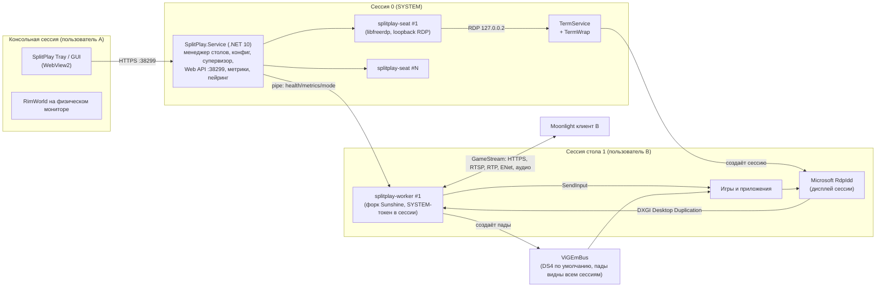
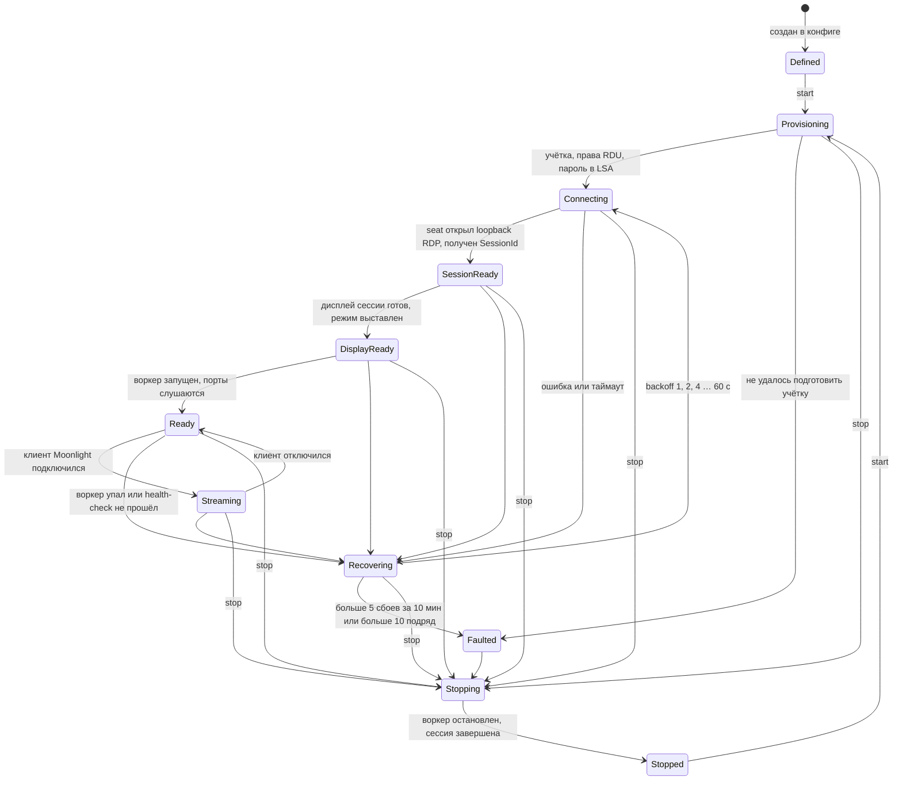

# SplitPlay — архитектурный документ (Этап 1)

Версия 0.3 · 2026-10-30 · статус: на согласовании (раздел 10: решения владельца от 2026-10-30, этап 4 без своих драйверов)

> **Решение владельца от 2026-10-30.** SplitPlay не ставит своих драйверов: нет своего IDD и драйвера геймпада, нет тестового режима Windows и выключенного Secure Boot, нет EV-сертификата. Захват остаётся DDA, геймпады — ViGEmBus (DualShock 4 по умолчанию). Исходники IDD (`drivers/idd`), драйвера падов (`drivers/pad`) и провайдера `splitplay-rdsprov.dll` (`native/rdsprov`) заморожены: остаются в репозитории, но не попадают в установщик. Где текст ниже описывает их как цель, действует [раздел 10](#10-решения-владельца-от-2026-10-30-без-своих-драйверов).

SplitPlay превращает один ПК с Windows в N независимых рабочих столов. Каждый стол — отдельная локальная учётная запись Windows в собственной интерактивной сессии со своими окнами, вводом, звуком и видеопотоком, который отдаётся в немодифицированный клиент Moonlight. Пользователь за физическим монитором (консольная сессия) продолжает работать как обычно.

Исходные исследования и их независимое ревью лежат в [`docs/research/`](research/). Утверждения, которые ещё не подтверждены на железе, вынесены в раздел 8 как лабораторные тесты MVP.

## 1. Ключевые решения

| Вопрос | Решение | Почему |
|---|---|---|
| Изолированный стол | Отдельная RDP-сессия Windows на пользователя, созданная loopback-подключением к самому себе (127.0.0.2). Одновременные сессии на клиентской Windows даёт TermWrap (MIT, патч termsrv в памяти). Он ставится по умолчанию, как у Duo, а риск лицензии раскрывается в установщике (решение владельца проекта от 2026-10-28). Режима Windows Server RDSH нет. | Только у отдельной сессии свои DWM, очередь ввода, аудио-эндпоинт и winlogon. `CreateDesktop` внутри одной сессии изоляции не даёт. Так же устроены Duo и Chrome Remote Desktop. |
| Создание сессии | `splitplay-seat.exe` на libfreerdp (Apache-2.0), по одному процессу на стол, в сессии 0 | Пароль не попадает в командную строку, редиректы (буфер, диски, USB, микрофон) выключены, звук в null-приёмник. Python (aardwolf, как у Duo) не нужен. |
| Захват и виртуальный дисплей | **DXGI Desktop Duplication** внутри обычной RdpIdd-сессии (дисплей сессии — Microsoft RdpIdd). Частоту задаёт композиция DWM в RDP-сессии (`DWMFRAMEINTERVAL`). Собственный remote-session IDD и провайдер-обёртка над `rdpcorets` **заморожены** (решение владельца от 2026-10-30, раздел 10). | Свой IDD без EV-сертификата работает только в тестовом режиме Windows с выключенным Secure Boot. Внедряться в RdpIdd через перехват смещений, как Duo, не будем: такое ломается каждым обновлением. |
| Сервер Moonlight | Форк upstream **Sunshine** («SplitPlay Worker», C++), один процесс на стол | Собственная реализация протокола (пейринг, RTSP, ENet+AES-GCM, RTP+FEC, Opus, около 30 типов ввода, RFI) заняла бы 9–15 чел.-мес. Форк обходится в 2–4. Совместимость с клиентами Moonlight уже проверена Sunshine. |
| Кодирование | Прямой NVENC SDK (P1, ultra-low-latency, бесконечный GOP, RFI, intra-refresh). По умолчанию HEVC, AV1 на Ada/Blackwell. AMF и QSV через FFmpeg как второй эшелон. | У NVENC P1 1080p один движок даёт 930–1130 fps для HEVC (официальные цифры NVIDIA). Это единственный путь с запасом на 500 Гц. |
| Ввод | Клавиатура и мышь: `SendInput` из воркера с SYSTEM-токеном в сессии стола (как у Chrome Remote Desktop). Геймпады: ViGEmBus (подписан Microsoft), его ставит установщик SplitPlay, если драйвера ещё нет. По умолчанию воркер создаёт DualShock 4: XInput отдаёт кнопки пада X360 только активному окну консоли (вибрация при этом доходит), а DS4 — HID-устройство, которое игры стола читают напрямую или через Steam Input. В дополнительных настройках стола можно выбрать Xbox 360. Пады глобальные: их видят все сессии, включая консольную. Собственного драйвера (UMDF2 + VHF, `DEVPKEY_Device_SessionId`) не будет (решения владельца от 2026-10-29 и 2026-10-30): без EV-сертификата он работает только в тестовом режиме Windows с выключенным Secure Boot. | Физические клавиатура и мышь принадлежат консольной сессии, а `SendInput` действует только в сессии вызывающего процесса. ViGEmBus снят с поддержки, X360 (XUSB) не изолируется по сессиям. libvirtualhid из Sunshine нельзя распространять (лицензия LizardByte SAL). |
| Звук | WASAPI loopback эндпоинта «Remote Audio» своей сессии (стерео), Opus 48 кГц | Эндпоинт у каждой сессии свой, поэтому изоляция получается без глобальных виртуальных устройств. Объёмный звук 5.1/7.1 и микрофон требуют своего аудиодрайвера с подписью Microsoft, поэтому их нет (раздел 10). |
| Служба, менеджер, UI | `SplitPlay.Service` на C#/.NET 10 (LocalSystem). Веб-интерфейс (Vue) на `:38299` через Kestrel. Трей-приложение с GUI на WebView2 открывает тот же веб-интерфейс. CLI `splitplay.exe`. | Удобный доступ к WTS, LSA, SCM, ACL и брандмауэру. Один UI на GUI и веб. Всё, что загружается в TermService, пишем только на нативном C++ без CLR. |
| Установщик | Inno Setup 6, один подписанный `SplitPlay-Setup-x.y.z.exe`, сборка в GitHub Actions | Нативно даёт один exe, бесплатен, установку драйверов, служб и правил брандмауэра легко описать скриптом. WiX v6+ требует платы Open Source Maintenance Fee, а MSI нам не нужен. |
| Лицензия | Воркер (форк Sunshine) под **GPL-3.0**, его исходники публикуем. Служба, UI, драйверы и провайдер остаются под **MIT** (как сейчас в репозитории). | Взаимодействие только через процессы, CLI, файлы, HTTP/JSON и простые сообщения в pipe, то есть «mere aggregation» по GPL FAQ. Код Sunshine в службу не линкуется. |

## 2. Компоненты

| Компонент | Язык | Где работает | Ответственность |
|---|---|---|---|
| **SplitPlay.Service** («служба») | C# .NET 10 | Сессия 0, LocalSystem | Координатор ресурсов хоста (глобальные `DWMFRAMEINTERVAL` и профили драйвера, бюджет сети, NVENC и VRAM, CPU sets) и живая подстройка воркеров. Конфигурация, учётки и секреты (LSA), конечный автомат каждого стола, запуск и перезапуск дочерних процессов (каждый в своём Job Object), порты и брандмауэр, Web API и SPA на 38299, агрегация метрик, оркестрация пейринга, самопроверка TermWrap при старте |
| **splitplay-seat** | C++ (libfreerdp) | Сессия 0 | Держит loopback RDP-подключение одного стола: NLA, канал rdpsnd с null-выходом, все редиректы выключены. Переподключается по команде службы. С Этапа 4 становится компонентом реального времени: принимает ввод от воркера через кольцо в разделяемой памяти и отдаёт его в сессию как настоящие RDP-устройства (MMCSS, отдельный поток ввода, watchdog) |
| ~~splitplay-rdsprov.dll~~ (заморожен) | C++ (нативный) | Внутри TermService | Задумывался как обёртка над `rdpcorets`, отдающая для loopback-подключений аппаратный ID нашего IDD. Исходники (`native/rdsprov`) собираются и тестируются в CI, но в установщик не входят и нигде не регистрируются |
| ~~SplitPlay IDD~~ (заморожен) | C++ UMDF2 IddCx | — | Remote-session драйвер с кольцом разделяемых текстур. Без EV-сертификата не загружается вне тестового режима. Исходники (`drivers/idd`) остаются, сборка — только при изменениях в `drivers/` |
| **splitplay-worker** («агент стола») | C++ (форк Sunshine, MinGW) | Сессия стола, SYSTEM-токен с `TokenSessionId` = N | Протокол Moonlight, захват DDA, конвертация в NV12/P010, кодирование, аудио, ввод, геймпады через ViGEmBus, запуск приложений под токеном пользователя. Управление (PIN, список клиентов, отзыв) идёт через управляющий pipe службы ([docs/contracts/ipc.md](contracts/ipc.md)), собственный веб-интерфейс Sunshine отключён |
| ~~splitplay-audioenum.dll~~ (не делаем) | — | — | Посессионный эндпоинт 5.1/7.1 и микрофон требуют своего аудиодрайвера с подписью Microsoft и провайдера в TermService (раздел 10) |
| **ViGEmBus** (сторонний, подписан Microsoft) | — | Драйвер | Виртуальные DualShock 4 (по умолчанию) и Xbox 360. Ставится установщиком SplitPlay, если его нет. Пады глобальные: их видят все сессии. Свой драйвер падов (`drivers/pad`) заморожен |
| **Tray / GUI, CLI** («менеджер») | C# + WebView2; C# | Сессия пользователя | GUI показывает тот же веб-интерфейс. Токен доступа выдаётся через pipe с ACL (только администраторы). CLI нужен для скриптов: `splitplay desktop start <имя>` |

## 3. Потоки данных

**Видео:** игра в сессии N → DWM этой сессии (частота композиции = `DWMFRAMEINTERVAL`) → дисплей Microsoft RdpIdd → DXGI Desktop Duplication в воркере (на GPU рендера сессии) → шейдер в NV12/P010 → NVENC → RTP с FEC Рида — Соломона и опциональным AES-GCM → UDP (база+9) → Moonlight. Всё происходит на одном GPU, без копирования через CPU.

**Ввод:** Moonlight → управляющий канал ENet с AES-GCM (база+10) → воркер. Клавиатура и мышь идут через `SendInput` (относительная мышь, скан-коды), а если `SendInput` не прошёл, воркер переключается на текущий input desktop (`OpenInputDesktop`/`SetThreadDesktop`), чтобы работали UAC и экран блокировки. Ввод идёт через абстракцию «приёмник ввода»: в MVP это `SendInput`, на Этапе 4 к нему добавляется путь через RDP-подключение seat-клиента (раздел 9). Ctrl+Alt+Del отправляет служба через `SendSAS`. Геймпады воркер создаёт через ViGEmBus (DualShock 4 по умолчанию). Такие пады глобальные, привязать их к сессии N без своего драйвера нельзя. Ввод физических устройств хоста в сессию N не попадает: Windows отдаёт его только консольной сессии.

**Звук:** приложения → «Remote Audio» сессии N (seat-клиент объявляет rdpsnd, `audiomode=0`, но сам ничего не воспроизводит) → WASAPI loopback в воркере → Opus → AES-CBC и FEC → UDP (база+11).

**Порты:** у стола k базовый порт `P = 48089 + 100·k` (настраивается, `host.basePortStart`/`basePortStride` в [config.md](contracts/config.md); 48089 вместо стандартного 47989, чтобы не конфликтовать с установленным Sunshine). Занимаются P−5 (HTTPS), P (HTTP), P+9, P+10, P+11 и P+21 (RTSP). В Moonlight стол добавляется как `IP:P`. Каждый воркер имеет свои `uniqueid` и сертификат, поэтому клиент видит столы как разные ПК. Имена в mDNS имеют вид `HOST-<стол>`. RDP 3389 закрыт для всего, кроме loopback.

## 4. Жизненный цикл стола и взаимодействие компонентов

`stop` принимается в любом состоянии, чтобы стол, застрявший в цикле повторов, всегда можно было остановить.

Сон и пробуждение ПК (Этап 3): служба получает `SERVICE_CONTROL_POWEREVENT`. Перед сном она корректно останавливает воркеры всех столов (сессия NVENC и захват DDA сон не переживают), а сами столы переходят в `Recovering` по триггеру `Pause`: это не сбой, бюджет повторов не тратится, seat и сессия остаются. После пробуждения триггер `Resume` ведёт стол в `Connecting`, и он получает новый воркер. Пока клиент Moonlight подключён к любому столу, служба держит запрос питания `PowerRequestSystemRequired`, и Windows не засыпает сама (настройка `host.keepAwake`, по умолчанию включена).

Границы повторов (Этап 3): кроме окна «5 сбоев за 10 минут» стол уходит в `Faulted` после 10 сбоев подряд без `Ready`, даже если они редкие (вход по RDP, который каждый раз упирается в таймаут 180 с, окно не заполняет). Подготовка учётки ограничена по времени (120 с): после перезагрузки или обновления Windows вызовы учёток и RDP могут зависнуть, тогда стол сразу получает `Faulted` с понятной причиной, а второй вызов рядом с зависшим не запускается (он мог бы перезаписать пароль). Ошибки подготовки, которые могут быть временными, повторяются 3 раза с паузой 5, 10 с. Потерянная RDP-сессия, которую seat не вернул за 180 с, считается сбоем: seat заменяется. При старте служба ждёт до 60 с службы удалённых рабочих столов и проверяет отключённые сессии пользователей столов, оставшиеся после падения или перезапуска: стол с автозапуском переподключается к своей сессии (игры продолжают работать), остальные сессии учёток, созданных SplitPlay, завершаются, сессии чужих учёток не трогаются никогда. Дочерние процессы и так умирают вместе со службой (job object).

Порядок взаимодействия «служба — агент — менеджер»:

1. Менеджер (веб, GUI или CLI) вызывает `POST /api/v1/desks/{id}/start` ([docs/contracts/web-api.md](contracts/web-api.md)). Служба проверяет конфиг и бюджет GPU (раздел 5).
2. Служба запускает `splitplay-seat` и ждёт событие `WTS_SESSION_LOGON` для нужного пользователя. SessionId каждый раз определяется заново: после перезагрузки он меняется, поэтому в конфиге его не храним.
3. Служба дублирует свой токен, ставит `TokenSessionId` = N и запускает воркер через `CreateProcessAsUser` в отдельном Job Object (job не может охватывать несколько сессий). Воркер получает свой каталог конфигурации и pipe `\\.\pipe\splitplay\worker-<id>`.
4. Воркер шлёт `ready`, затем раз в секунду heartbeat с метриками (fps, битрейт, задержка кодирования, потери, загрузка GPU и NVENC). Если 3 heartbeat подряд пропущены, служба убивает воркер и перезапускает его. Остальные столы при этом не затрагиваются.
5. «Pair New Client»: менеджер показывает форму PIN, служба передаёт PIN нужному воркеру сообщением `pair` по его управляющему pipe. Список клиентов и отзыв доступа делаются так же, сообщениями `list_clients` и `unpair`.
6. Автозапуск: служба стартует автоматически (обычный автозапуск, не отложенный: трей при входе должен её застать) и поднимает столы с флагом `autostart`. Трей запускается при входе пользователя.

**Границы изоляции сбоев.** Сбой игры, воркера или DWM сессии затрагивает только свой стол. Общими для всех столов остаются TermService (его перезапуск роняет все сессии), сброс GPU (TDR, затрагивает в том числе консоль), драйверы ядра и ViGEmBus. Поэтому служба восстанавливает столы идемпотентно, а своего кода в TermService, кроме TermWrap, нет.

## 5. Как достигаются 500 Гц и где реальный потолок

Изначально цепочка рассчитывалась так, чтобы ни одно звено не ограничивало частоту ниже 500 Гц. Без своего IDD (раздел 10) звено 1 становится потолком: 240–250 Гц реальны, 500 Гц — только если DWM в RDP-сессии их даст. Это меряет лабораторный тест A.

1. **Композиция.** В remote-сессиях DWM ограничен значением `DWMFRAMEINTERVAL` (целые мс, по умолчанию 33 мс, то есть 30 fps). Ставим 4 мс (250 Гц) по умолчанию и 2 мс в профиле «500 Гц». Параметр глобальный для всех remote-сессий, поэтому служба выставляет его по самому быстрому активному столу.
2. **Дисплей.** Дисплей сессии — Microsoft RdpIdd. Размер выставляет seat под `mode=WxHxFPS` клиента; частоту обновления этого дисплея мы не контролируем, её задаёт композиция из п. 1.
3. **Захват.** DXGI Desktop Duplication в воркере. Сейчас новый кадр ждёт слота потока (в среднем пол-интервала); захват по приходу кадра — отдельный PR этапа 4. Воркер выдаёт кадры с частотой клиента: таймер `CREATE_WAITABLE_TIMER_HIGH_RESOLUTION`, повтор последнего кадра, если изображение не менялось. У WGC-пути Sunshine есть ограничение 250 Гц (`MinUpdateInterval(4ms)`), но этот путь мы не используем.
4. **Кодирование.** NVENC P1, HEVC Main (уровень 5.2 допускает около 515 fps при 1080p). H.264 при 500 fps требует уровня 6.0, поэтому в профиле «500 Гц» по умолчанию HEVC или AV1. CBR с VBV в один кадр, без B-кадров и lookahead, RFI вместо IDR, intra-refresh против всплесков. Один поток не превышает пропускную способность одного движка NVENC.
5. **Сеть.** Протокол Moonlight без изменений: 60–150 Мбит/с, около 11–16 тыс. пакетов/с, проводной Ethernet. На хосте нужен 2,5 GbE, если столов несколько.
6. **Клиент.** moonlight-qt разрешает свою частоту от 10 до 9999 fps и битрейт до 500 Мбит/с (экспериментальный разблок). Для 500 Гц нужны декодер с HEVC L5.2 и экран 360–500 Гц. Android по умолчанию ограничен 120 Гц.

**Контроль допуска.** У каждого GPU есть бюджет примерно 900–1100 «1080p-эквивалентных кадров в секунду» на движок NVENC. На GeForce действует лимит 12 одновременных сессий кодирования на всю систему, и OBS с ShadowPlay в него тоже входят. Стол, который не помещается в бюджет, стартует с пониженным fps и предупреждением.

**Честный потолок (до лабораторного подтверждения).** Колонка «Best effort» без своего IDD — «если DWM в RDP-сессии даст такую частоту». 1440p500 через split-frame encoding недоступен: у RTX 5070 один движок NVENC.

| Железо | Гарантируем | Best effort |
|---|---|---|
| NVIDIA Ada / Blackwell | 1080p 240–250 Гц на 2–3 стола | 1080p500 на 1–2 стола |
| NVIDIA Turing / Ampere | 1080p 240 Гц | 1080p500 на 1 стол |
| Intel Arc | 1080p 240 Гц | 720p500 |
| AMD | 1080p 144 Гц | 240–360 Гц (публичных замеров нет) |

Практический предел при нескольких столах задаёт не энкодер, а рендеринг игр и композиция DWM на общем GPU. Если `DWMFRAMEINTERVAL=2` на практике не даёт 500 Гц, мы задокументируем 333 или 250 Гц как реальный потолок. Это допускается критериями готовности.

**Бюджет задержки (оценка).** При 1080p500: захват ≈1 мс, конвертация 0,2 мс, кодирование ≈1 мс, отправка и сеть ≈1 мс, декодирование 1–3 мс, вывод ≈1 мс, итого 5–8 мс. При 1080p60 видео укладывается в 20–35 мс (цель ≤ 50 мс). Ввод: сеть и ENet меньше 2 мс, `SendInput` меньше 1 мс, так что цель ≤ 30 мс определяется частотой кадров игры.

**Дополнительные видеофункции.** Суперсэмплинг: seat выставляет режим выше потока, воркер уменьшает его шейдером перед NVENC (без IDD — только в пределах режимов RdpIdd). HDR: дисплей сессии — RdpIdd, HDR он включает только для RDP-клиента с HDR через GFX, а seat работает без GFX, поэтому HDR почти наверняка недоступен; отдельный PR этапа 4 это проверяет, иначе поток идёт как SDR. Масштаб рабочего стола: seat-клиент передаёт `DesktopScaleFactor` при подключении RDP, при смене масштаба переподключается.

## 6. Конфигурация, безопасность, сборка

- **Конфиг:** `C:\ProgramData\SplitPlay\config.json`. Версионированная JSON-схема, валидация при загрузке, атомарная запись через временный файл и `MoveFileEx`. У каждого стола свой каталог `desks\<id>\` с конфигом воркера (генерируется из `config.json`), сертификатами, `state.json` (пейринг, uniqueid) и логами. Каталог закрыт ACL: доступ только у SYSTEM и администраторов.
- **Секреты:** пароли пользователей столов (генерируются случайно) хранятся в LSA private data, учётные данные воркеров и хэш пароля веб-интерфейса (Argon2id) — в DPAPI-machine.
- **Импорт и экспорт:** zip с `config.json` и сертификатами пейринга. Секреты включаются только по запросу и шифруются паролем экспорта.
- **Веб-интерфейс:** по умолчанию слушает только localhost. Доступ из LAN включается флагом: тогда HTTPS с самоподписанным сертификатом, пароль администратора, ограничение частоты запросов и CSRF-токены. Ошибки показываются там же: логи служебных процессов, метрики через WebSocket.
- **Логи:** структурированные JSON-строки с ротацией в `ProgramData\SplitPlay\logs`.
- **Репозиторий:** `service/` (.NET), `worker/` (upstream Sunshine, закреплённый на коммите в `worker/upstream.lock`, и очередь патчей `worker/patches/*.patch`, которая накладывается при сборке; отдельный репозиторий-форк не нужен), `native/` (seat, заглушки, TermWrap; замороженный `native/rdsprov`), `drivers/idd` и `drivers/pad` (заморожены), `web/` (Vue), `installer/` (Inno), `docs/`.
- **CI (GitHub Actions, windows-2022):** воркер собирается в MSYS2 UCRT64, служба через `dotnet publish` (self-contained), затем Inno Setup и подпись. Замороженные драйверы собираются (MSBuild, WDK из NuGet) только при изменениях в `drivers/` и в установщик не входят. Пользовательский код подписывается Azure Artifact Signing; EV-сертификата нет и не будет. Сквозные тесты с GPU и мультисессиями требуют self-hosted раннера на Windows 11 с NVIDIA.
- **Установщик** ставит службу, файлы, правила брандмауэра, политики RDP (WDDM, тайм-ауты отключения, `DWMFRAMEINTERVAL`), WebView2 и, если его нет, ViGEmBus (официальный подписанный установщик). Своих драйверов не ставит. TermWrap ставится по умолчанию. На странице лицензии установщик прямо говорит, что патч termsrv нарушает лицензию Windows для клиентских редакций. Деинсталлятор возвращает настройки RDP и TermService, удаляет ViGEmBus (только если ставил его сам) и правила брандмауэра, а учётные записи пользователей не удаляет без подтверждения.

## 7. Риски и ограничения платформы

| # | Риск | Влияние | Как снижаем |
|---|---|---|---|
| 1 | **Лицензия Windows.** Одновременные сессии на клиентской Windows нарушают §2(c)(iv) и (v) EULA. Патч нужен и «чистому» пути через IDD (NonRDPPatch). | Юридический и репутационный риск, детекты антивирусов | Принятый риск (решение владельца проекта): TermWrap по умолчанию, риск раскрыт в установщике и README, юридическая консультация до публичного релиза |
| 2 | Обновления Windows меняют termsrv, rdpcorets и IddCx | Столы перестают подниматься после Patch Tuesday | Самопроверка при старте, откат в режим «только консоль», CI-кольцо на Release Preview, TermWrap ищет точки патча во время выполнения |
| 3 | Без своего IDD частоту задаёт композиция DWM в RDP-сессии, курсор и режим дисплея не наши | 500 Гц не гарантируются, HDR почти наверняка недоступен | Захват по приходу кадра для DDA, замер реального потолка (лаб. A), проба HDR; свой IDD заморожен (раздел 10) |
| 4 | 500 Гц: значение `DWMFRAMEINTERVAL=2` может игнорироваться, стоимость композиции растёт пропорционально N | Не достигаем 500 Гц | Гарантируем 250 Гц, 500 Гц как best effort, замер реального потолка |
| 5 | Античиты (флаг remote session, `LLMHF_INJECTED`, виртуальный HID, чужая DLL в TermService) | Часть игр не запускается во втором столе | Тестовая матрица (EAC, BattlEye, Vanguard, FACEIT); попробовать ввод через сам RDP-канал |
| 6 | Геймпады: XInput даёт 4 слота на всю машину, уже открытые хэндлы переживают изоляцию, Steam Input захватывает пады во всех сессиях | Пад «протекает» в чужой стол | DS4 по умолчанию, изоляция Steam. Пады ViGEmBus глобальные: изоляция по сессиям и профили DualSense/Xbox Series без своего драйвера невозможны |
| 7 | Общий GPU: игра A отнимает время у DWM и NVENC стола B, TDR роняет всё | Просадки fps, общий сбой | Контроль допуска, приоритеты планировщика GPU, выбор рендер-GPU для каждого стола |
| 8 | Звук «Remote Audio» только стерео 44,1 кГц | Нет 5.1/7.1 и микрофона | Принято: свой аудиодрайвер требует подписи Microsoft (раздел 10) |
| 9 | ~~Подпись драйверов~~ | — | Снят: своих драйверов SplitPlay не ставит, EV-сертификат не нужен (решение владельца от 2026-10-30) |
| 10 | В remote-сессиях нет эксклюзивного полноэкранного режима и VRR | До одного кадра композиции задержки | Режим «borderless», документировать ограничение |
| 11 | В upstream Sunshine около 860 коммитов в год, причём в нём есть код под SAL | Дорогие ребейзы, риск лицензии | Минимальная очередь патчей, CI-проверка SPDX-заголовков |
| 12 | На одной видеокарте полной изоляции производительности не бывает: WDDM делит время GPU между процессами, лимитов VRAM на процесс нет | Тяжёлая игра в столе B снижает fps у A | Ограничение fps каждого стола, приоритет конвейера стриминга, контроль допуска; для жёсткой изоляции — отдельная видеокарта на тяжёлый стол |
| 13 | ~~Аудио-DLL во всех процессах сессии~~ | — | Снят вместе с аудио-DLL (раздел 10) |

Минимальная ОС: Windows 11 Pro или Enterprise 24H2 (26100) и выше. Поддержка Home не гарантируется. У учётных записей столов обязателен пароль: этого требует NLA, а учётные записи Microsoft не поддерживаются.

## 8. Этапы, сроки и проверки

Оценка дана для команды из 3–4 инженеров, один из которых знает драйверы Windows и RDS. Код пишу я, поэтому календарные сроки этапов 2–3 могут быть короче, но сквозные тесты требуют реального ПК с Windows 11 и GPU NVIDIA: в облачном CI нет GPU и мультисессий.

| Этап | Содержание | Чел.-недели |
|---|---|---|
| 2. Скелет | Монорепозиторий; CI (MSYS2, .NET, WDK, Inno); форк Sunshine без libvirtualhid и ViGEm; служба с install/uninstall; seat-заглушка; заглушки захвата, энкодера и сети; установщик-заглушка; задел из раздела 9 (трассировка кадров, событийный контракт захвата, приёмник ввода, живой профиль настроек) | 11–14 |
| 3. MVP | TermWrap, один стол, воркер с SYSTEM-токеном в сессии, захват DDA, NVENC, `SendInput`, Remote Audio, пейринг через воркер, минимальный веб с кнопками старт/стоп; автозапуск нужных служб (служба SplitPlay поднимает TermService и UmRdpService, трей запускает службу SplitPlay и показывает свою страницу, пока веб недоступен) и панель «Службы» в веб-интерфейсе со статусом и кнопками запуска и остановки; быстрые улучшения из раздела 9 | 13–18 |
| 4. Расширение | Мультистол, порты, mDNS и брандмауэр (6–8); ~~remote IDD и провайдер~~, 240/500 Гц на DDA; ~~звук 5.1/7.1~~; ~~свой драйвер геймпадов~~; проба HDR; централизованный PIN и полноценный GUI (6–8); улучшения Этапа 4 из раздела 9, которые возможны без своих драйверов. Порядок работ — раздел 10 | пересчитывается |
| 5. Стабилизация | Восстановление после сбоев, кольцо обновлений Windows, матрица античитов и антивирусов, soak-тесты, smoke- и интеграционные тесты, README, FAQ; улучшения Этапа 5 из раздела 9 (12–18) | 26–38 |
| **Итого** | | **≈105–146 (12–17 мес.)**; без раздела 9 ≈74–102 |

Лабораторные тесты, которые MVP обязан закрыть:

1. Реальная частота композиции при `DWMFRAMEINTERVAL` = 2, 3 и 4 для N = 1, 2 и 4.
2. Жизненный цикл сессии: переподключение, перезапуск TermService, kill воркера.
3. `SendInput` против ввода через RDP-канал: задержка, Raw Input, античиты.
4. Матрица изоляции геймпадов.
5. Отсутствие утечки звука на колонки хоста.
6. Ёмкость NVENC и лимит в 12 сессий.
7. Сквозной 1080p500 на moonlight-qt и glass-to-glass при 1080p60 (≤ 50 мс).
8. Переживание Patch Tuesday.
9. Радиус поражения TDR.

Полный список лабораторных тестов с учётом раздела 9 (18 пунктов) приведён в [`research/11-review-round2.md`](research/11-review-round2.md).

## 9. Максимальный вариант: что выжимаем сверх базы

Второй круг исследования ([`research/07–11`](research/)) искал улучшения без оглядки на сложность. Все пункты ниже работают с немодифицированным Moonlight, если не помечено иное. Выигрыш везде оценочный и подтверждается тестами.

**Что меняется в архитектуре уже сейчас (закладываем в скелет):**

1. **Контракт захвата.** IDD владеет кольцом текстур и GPU-fence, сообщает о новом кадре событием с меткой QPC. Воркер не опрашивает, а кодирует кадр сразу по приходу. Курсор и HDR-метаданные передаются отдельными полями, конвертация цвета и наложение курсора делаются одним проходом на высокоприоритетной очереди D3D12. *Заморожено вместе с IDD (раздел 10); для DDA остаётся только кодирование сразу по приходу кадра.*
2. **Приёмник ввода.** Ввод отделён от воркера интерфейсом. Вторая реализация передаёт клавиатуру, кнопки, колесо и Ctrl+Alt+Del в seat-клиент, а тот отправляет их в сессию как настоящие RDP-устройства: без флага «инъекция», с работающими UAC и SAS. Относительное движение мыши остаётся на `SendInput`, если сервер не объявляет relative mouse. Протокол воркер ↔ seat документирован, это граница GPL.
3. **Служба — координатор ресурсов.** Только она меняет глобальные параметры (`DWMFRAMEINTERVAL`, профили драйвера NVIDIA, бюджет сетевой карты, допуск по NVENC и VRAM, CPU sets). Профиль каждого стола (pacing, FEC, DPB, минимальный fps, приоритеты, лимит fps) меняется на лету через pipe.
4. **Измерения с первого дня.** Сквозной ID кадра и метки QPC от IDD до RTP-пакета, ETW во всех компонентах, PresentMon. Для Этапа 4 нужны ПК с Windows 11 и NVIDIA в CI и стенд glass-to-glass (LDAT или OSLTT).
5. **Установщик с обратимым «манифестом настройки хоста».** План питания и парковка ядер, Energy-Efficient Ethernet и pause-кадры на сетевой карте, профили драйвера, MMCSS, уровень `DWMFRAMEINTERVAL`. При удалении всё возвращается. Он же генерирует «пакет запуска» для клиентов Moonlight.

**Дорожная карта улучшений:**

| Этап | Улучшение | Выигрыш |
|---|---|---|
| 3 | Мгновенная доставка вибрации и HDR-метаданных (сейчас они ждут цикл управления Sunshine до ~100 мс) | вибрация ≤ 1 мс вместо ~100 мс |
| 3 | Пакет запуска клиента: V-Sync выключен или VRR, полный экран, HEVC, D3D11VA | ≈8 мс в среднем на клиенте 60 Гц — самый большой единичный выигрыш |
| 3 | Защита от планировщика: отказ от EcoQoS и троттлинга таймера, MMCSS для потоков кодирования, отправки и ввода, отдельный поток ввода | p99-джиттер с нескольких мс до долей мс при N играх |
| 3 | DPB 16 кадров вместо 5 (RFI вместо IDR при потерях), минимальный fps 10–20 для простаивающих столов, профиль «максимальная производительность» на exe воркера | меньше всплесков IDR, свободная ёмкость NVENC |
| 3 | Настраиваемая скорость отправки вместо зашитых 800 Мбит/с | 1–2 мс на кадр при 2,5 GbE |
| 4 | ~~Кольцо IDD с fence, поздний курсор~~ (невозможно без своего IDD); кодирование по приходу кадра для DDA | до 8 мс при 60 Гц (зависит от фазы) |
| 4 | Менеджер лимитов fps для игр (ограничитель и профили драйвера NVIDIA; режим IDD невозможен) | главный рычаг изоляции на общей видеокарте |
| 4 | Общий бюджет сетевой карты на все столы и разнесение их по фазе; адаптивные FEC и битрейт по телеметрии потерь, которую Sunshine сейчас игнорирует | 0,5–3 мс, минус 10–15 % трафика |
| 4 | Контроль допуска и метрики в UI (GPU, VRAM, NVENC), восстановление после TDR | без перегрузки и общих фризов |
| 4 | CPU sets и Job Object на стол, политика для X3D (один стол на CCD) и гибридных ядер Intel | ровнее время кадра |
| 4 | Ввод через RDP-подключение (под флагом, гибридный вариант) | настоящие устройства, меньше проблем с античитами |
| 4 | ~~Split-frame encoding для одного быстрого стола~~ (у RTX 5070 один движок NVENC — ограничение железа) | 1440p500 |
| 5 | ~~Собственный посессионный аудио-эндпоинт 5.1/7.1 и микрофон~~ (нужен аудиодрайвер с подписью Microsoft) | объёмный звук без патчей rdpendp и без утечек |
| 5 | Отправка срезов кадра по мере кодирования (HEVC/H.264), данные раньше FEC-паритета | 0,5–1,5 мс при 60 fps |
| 5 | Совместимость игр по белому списку (скрыть RDP, exclusive fullscreen в borderless, изоляция Steam), отдельная видеокарта на тяжёлый стол, iGPU для лёгких столов | совместимость, жёсткая изоляция |
| Опция | Форк Moonlight (ненадёжные пакеты мыши, пакетирование < 1 мс, микрофон); виртуальные USB-устройства через RDP (настоящий X360-пад, DualSense с хаптикой); ~~кодировщик внутри процесса IDD~~; захват через хук Present | 0,2–8 мс, полная поддержка падов; высокий риск |

**Качество картинки при той же задержке:** автоподбор пресета NVENC по запасу времени (P4–P5 при 60 fps, P1 при 500 Гц), адаптивная квантизация, 10-битное кодирование даже для SDR (меньше бандинга), режим YUV 4:4:4 для работы с текстом, калибровка под каждого клиента, пул заранее поднятых сессий для мгновенного старта.

**Чего не выжать даже «без ограничений»:** на одной видеокарте нельзя гарантировать полное отсутствие влияния между тяжёлыми играми, это даёт только отдельная видеокарта на стол. Задержку V-Sync на клиенте хост убрать не может, только подсказать настройки. Аппаратное разделение GPU (MIG на RTX PRO Blackwell) работает только с виртуальными машинами — это другой продукт.

## 10. Решения владельца от 2026-10-30: без своих драйверов

**Не делаем:**

- свой IDD и свой драйвер геймпада, тестовый режим Windows, выключенный Secure Boot, EV-сертификат;
- патчи RdpIdd/IddCx в памяти, как у Duo.

**Остаётся как есть:** захват DDA, геймпады через ViGEmBus, DualShock 4 по умолчанию.

**Заморожено.** Исходники `drivers/idd`, `drivers/pad` и `native/rdsprov` остаются в репозитории. Драйверы собираются в CI только при изменениях в `drivers/`, `splitplay-rdsprov.dll` собирается и тестируется вместе с `native/`. Ни драйверы, ни `splitplay-rdsprov.dll` в установщик не входят: служба, seat и воркер их не загружают и не регистрируют. Контракт [`contracts/drivers.md`](contracts/drivers.md) сохранён для истории.

**Что без своих драйверов невозможно (честно):**

| Возможность | Почему | Что вместо |
|---|---|---|
| Кольцо IDD: кодирование прямо из IDD, поздний курсор, режим дисплея под частоту клиента | Нужен свой remote-session IDD | Частично: захват по приходу кадра для DDA |
| 500 Гц как гарантия | Частота упирается в композицию DWM в RDP-сессии | 240–250 Гц реальны, 500 Гц — «если получится»; замер (лаб. A) |
| HDR | Дисплей сессии — RdpIdd: HDR только для RDP-клиента с HDR через GFX, а seat работает без GFX | Проба HDR; если её нет, поток идёт как SDR |
| Изоляция геймпадов по сессиям; профили DualSense и Xbox Series | Нужен свой драйвер падов | ViGEmBus, пады видны всем сессиям; DS4 по умолчанию |
| Объёмный звук 5.1/7.1 и микрофон | Нужен свой аудиодрайвер с подписью Microsoft | Стерео через Remote Audio |
| Split-frame encoding для 1440p500 | У RTX 5070 один движок NVENC — ограничение железа | — |

**Порядок PR этапа 4** (номера патчей воркера закреплены): 1 — документ и установщик под эти решения; 2 — несколько столов: mDNS (патч 0017), порты, сеть; 3 — кадр сразу по готовности (0018); 4 — GPU, VRAM и NVENC в интерфейсе; 5 — проба HDR (0019); 6 — профили драйвера NVIDIA в службе (0020); 7 — лимиты FPS игр; 8 — единый PIN и трей (0021); 9 — контроль нагрузки и восстановление после сброса GPU (0022); 10–11 — телеметрия потерь (0023), адаптивные FEC и битрейт; 12 — ядра процессора для столов; 13 — ввод через RDP (0024).
